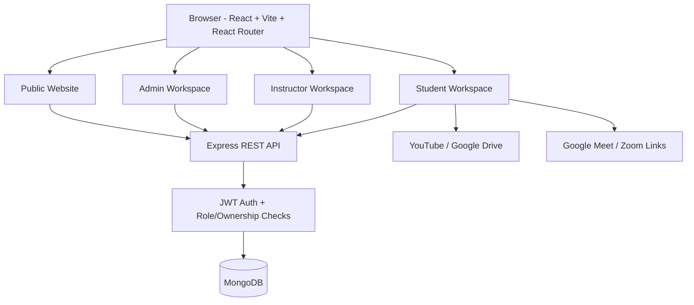

# Bitstek Learning v2 — Architecture & Roles

## Product boundaries

**Current commercial workflow:** Students enquire publicly. Payments are collected separately (cash / UPI / bank transfer / other). An administrator creates credentials, records and verifies the payment, and explicitly enrolls a student. No cart, checkout, fee collection, or open public registration is built into this application.

**Public experience:** Individually routed React pages for Home, Courses, Course Details, Learning Paths, About, Instructors, Corporate Training, Blog, Article, FAQ, How It Works, Contact and Login. Home and Contact use administrator-managed CMS text; course catalog and detail come from MongoDB if API is available. Sample content is a fallback for visual preview when API is unreachable.

**Portals:**
- `/admin`: admin metrics, people, temporary passwords, courses, syllabus, enrollments, manual payment verification, timetable, announcements, inquiries, website settings.
- `/instructor`: assigned-course curriculum, scheduling, roster, course announcements, profile.
- `/student`: enrolled lessons (YouTube / Drive links), progress, weekly schedule, announcements, profile.
- `/corporate-portal`: explicit design placeholder only. Do not treat this as a live corporate LMS.

## Dependency diagram

## Authorization matrix

| Ability | Admin | Instructor | Student |
|---|---:|---:|---:|
| Create / disable / reset account | yes | no | no |
| Publish course / change metadata | yes | no | no |
| Assign instructor | yes | no | no |
| Add / update / remove modules and lessons | all | assigned courses | no |
| Record / verify manual payments | yes | no | no |
| Enroll / pause / revoke students | yes | no | no |
| Create / reschedule / cancel live classes | all | assigned courses | no |
| Publish announcements | global or course | assigned course | no |
| Read announcements | all | assigned courses | enrolled course + global |
| Access lesson videos | admin editor | assigned course editor | enrolled course only |
| Edit website contact / hero text | yes | no | no |

All role and ownership constraints are checked on the Express API, independent of React's navigation.

## MongoDB collections

- `users` — role, credentials hash, active status, forced password change, token version.
- `courses` — public metadata, course outcomes, instructor ID, embedded modules and lessons.
- `enrollments` — unique `(student,course)` membership, status, approving admin, optionally verified payment.
- `payments` — administrative record of cash/UPI/bank/other, reference, verification status.
- `sessions` — instructor, course, title, UTC times, timezone, meeting URL, status.
- `progresses` — lesson IDs marked complete by a student in an enrolled course.
- `enquiries` — course/corporate enquiry intake.
- `sitecontents` — website hero text, CTA, contact email, WhatsApp number and location.
- `announcements` — global or course-scoped messages, author, publication status.

## Key API routes

Public: `GET /api/public/courses`, `GET /api/public/courses/:slug`, `GET /api/public/content`, `POST /api/public/enquiries`.

Auth: `POST /api/auth/login`, `GET /api/auth/me`, `POST /api/auth/change-password`.

Admin: `/api/admin/users`, `/api/admin/users/:id/reset-password`, `/api/admin/courses`, `/api/admin/enrollments`, `/api/admin/payments`, `/api/admin/schedule`, `/api/admin/announcements`, `/api/admin/enquiries`, `/api/admin/content`.

Instructor: `/api/instructor/courses`, `/api/instructor/students`, `/api/instructor/schedule`, `/api/instructor/announcements`.

Student: `/api/student/courses`, `/api/student/schedule`, `/api/student/announcements`, `POST /api/student/progress/:courseId/:lessonId`.

Shared authoring: `POST /api/courses/:courseId/modules`, `PATCH|DELETE /api/courses/:courseId/modules/:moduleId`, `POST /api/courses/:courseId/modules/:moduleId/lessons`, `PATCH|DELETE /api/courses/:courseId/modules/:moduleId/lessons/:lessonId`.

## Live session scheduling

1. Admin assigns an instructor to a course.
2. Instructor creates a session with title, start/end dates, IANA timezone, notes and optional meeting URL.
3. API validates course assignment, active instructor, positive bounded duration, URL and scheduling conflict.
4. Records are stored as UTC timestamps and displayed in the user's browser timezone; weekly calendar and table reflect the same records.
5. Admin may modify any session; instructors may modify sessions in their own assigned courses.
6. Enrolled students see upcoming sessions, including their live meeting links.

**Concurrency note:** Overlap checks are an application-level query. Simultaneous requests can race. Before production, add robust conflict locking/transactions and integration tests against MongoDB.

## Security and video limitations

- New users receive administrator-generated temporary passwords, must change their password on first login; resetting changes `tokenVersion` and invalidates older bearer JWTs.
- Backend checks role, enrollment, course ownership and published preview status. Public course endpoints redact private lesson URLs.
- YouTube and Google Drive video links are embedded by allowlisted hostname parser. Provider playback depends on video sharing settings; unlisted or shared links are copyable and are not DRM.
- `sessionStorage` bearer JWT is used for the starter. Harden security further before release: short lived tokens/refresh rotation, CSP, secure cookies if appropriate, throttling, MFA for admin, secret management, audit trails, backups, DSR/legal compliance.
- Offline amounts currently use decimal numeric storage suitable for demonstration, **not certified accounting**. Convert to integer minor units or Decimal128 with a reconciliation strategy before using this as an authoritative financial ledger.
- No emails or WhatsApp credentials are sent automatically. Admin must share login information securely.

## Production readiness / explicit exclusions

Implemented in source: public website, backend collections and routes, admin manual enrollment workflow, instructor schedules, weekly calendars, lessons, progress, announcements, editable website fields, password rotation and role access checks.

Not implemented: real corporate tenant segmentation, exam grading, certificates, email/WhatsApp delivery, payment gateway, invoicing/tax compliance, fully featured article CMS, bulk import, automatic invoices, production DRM, distributed lock for scheduling and comprehensive automated integration tests.

## Smoke test plan

- [ ] Start MongoDB, seed admin, change temporary password, re-login.
- [ ] Admin creates an instructor and a student, and assigns an instructor to a course.
- [ ] Instructor adds a module, adds a YouTube and Drive lesson, renames a module, schedules a class.
- [ ] Confirm instructor **cannot** create sessions for an unassigned course.
- [ ] Confirm conflicting schedule returns HTTP 409.
- [ ] Submit a public enquiry and confirm the admin receives it.
- [ ] Admin records a cash/UPI payment, verifies it, approves enrollment for matching student/course.
- [ ] Student can access only enrolled videos, see course announcements and live sessions, and mark lesson complete.
- [ ] Admin resets student password: old JWT stops working; student changes temporary password on next login.
- [ ] Admin edits CMS fields and verifies public homepage and contact details update.
- [ ] Manually test layout at 375px, 768px, 1024px and desktop and test keyboard navigation.
- [ ] Run `npm test --prefix server`; later add E2E and database integration tests.
